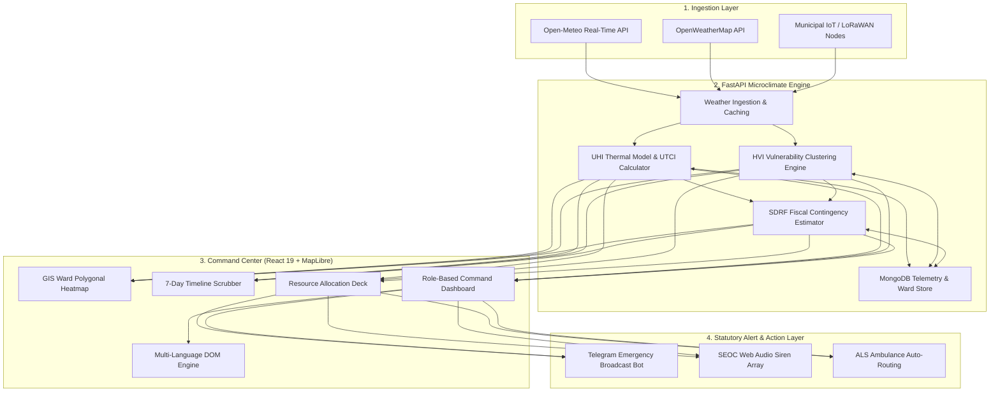

<div align="center">

# 🌡️ HeatRisk AI: GIS Ward-Level Heatwave Early Warning & Microclimate DSS
### Municipal Disaster Operations Command Center & Human Mortality Prediction System
*Aligned with NDMA (National Disaster Management Authority) Heat Action Plan (HAP) Guidelines*

---

<!-- Badges Strip -->
[](https://python.org)
[](https://fastapi.tiangolo.com)
[](https://typescriptlang.org)
[](https://react.dev)
[](https://vitejs.dev)
[](https://tailwindcss.com)
[](https://mongodb.com)
[](https://maplibre.org)
[](https://core.telegram.org/bots/api)

</div>

---

## 📌 Executive Summary

Standard meteorological forecasts only output macro city-level figures (e.g., *"Delhi 43°C"*), completely overlooking the **Urban Heat Island (UHI)** effect, concrete density variations, and socio-demographic vulnerabilities. 

**HeatRisk AI** transforms raw meteorological telemetry into actionable, **ward-level biometeorological decision support (DSS)**. It models micro-climatic thermal stress across individual wards, projects health vulnerabilities, automates statutory multi-channel emergency dispatches via **Telegram**, and coordinates ground relief assets (ALS Ice Immersion Ambulances, Water Tankers, and Air-Conditioned Cooling Shelters).

---

## 🚀 Key System Features

### 1. 🗺️ Ward-Level GIS Spatial Mapping
- Interactive geospatial rendering via **MapLibre GL JS** with custom ward polygon boundaries.
- **7-Day Dynamic Forecast Scrubber** (+0h to +168h) with automated playback updating map choropleths, telemetry cards, and analytical curves simultaneously.
- Urban Heat Island (UHI) regression offsets based on **NDVI (Vegetation Index)** and **Built-Up Impervious Pavement Density**.

### 2. 🧬 Biometeorological & Vulnerability Indices
- **UTCI (Universal Thermal Climate Index)**: Assesses apparent physiological thermal stress on the human body.
- **WBGT (Wet Bulb Globe Temperature)**: Wet-bulb heat and humidity calculation indicating outdoor labor safety thresholds.
- **HVI (Heat Vulnerability Index)**: Multi-parameter composite index assessing slum density, informal housing, percentage of elderly residents, and outdoor gig/construction workers.

### 3. 🚨 Real Multi-Channel Emergency Dispatch (Telegram Gateway)
- Verified **Telegram Bot Gateway** integration that pushes instant statutory emergency red alerts to field officers and citizen broadcast channels.
- Real-time audio siren synthesizer using Web Audio API for State Emergency Operations Center (SEOC) acoustic warning.

### 4. 🚑 Ground Resource Allocation & Logistics
- Intelligent routing and 1-click dispatch for:
  - **ALS Mobile Ambulances** with Cold Water Immersion Units for heatstroke triage.
  - **Emergency Water Tankers** routed to high-risk transit hubs and informal settlements.
  - **Air-Conditioned Cooling Shelters** with live operational capacity tracking.

### 5. 💰 SDRF & Disaster Reserve Fund Burn Tracker
- Dynamic tracking of **State Disaster Response Fund (SDRF)** contingency allocations.
- Real-time fiscal burn rate calculated from daily heat index thresholds, fuel consumption, and emergency supply deployment.

### 6. 👮 Role-Based Access Control (RBAC)
- **Controller (SEOC L4)**: National Supreme Clearance, master siren array, inter-agency broadcast bridges.
- **Disaster Management Officer (MUNI L3)**: Citizen directives, school timings, and statutory outdoor labor ban orders.
- **Field Lead (TACT L2)**: Ground SOS tickets, medical evacuation queues, and water replenishment tracking.

### 7. 🤖 Multilingual AI Agent Advisory ("Ask AI")
- Natural language biometeorological assistant powered by Groq / Gemini / LangFlow LLMs.
- Real-time queries for heatstroke first aid, comparative city weather, and domestic ORS preparation.

---

## 🌐 Supported Languages & Localization

The platform features an automated DOM translation engine and AI advisory supporting **12 regional Indian languages**:

| Flag | Language | Native Name | Code | Flag | Language | Native Name | Code |
| :---: | :--- | :--- | :---: | :---: | :--- | :--- | :---: |
| 🇬🇧 | **English** | English | `en` | 🇮🇳 | **Tamil** | தமிழ் | `ta` |
| 🇮🇳 | **Hindi** | हिन्दी | `hi` | 🇮🇳 | **Telugu** | తెలుగు | `te` |
| 🇮🇳 | **Hinglish** | Hinglish | `hinglish` | 🇮🇳 | **Gujarati** | ગુજરાતી | `gu` |
| 🇮🇳 | **Bengali** | বাংলা | `bn` | 🇮🇳 | **Punjabi** | ਪੰਜਾਬੀ | `pa` |
| 🇮🇳 | **Marathi** | मराठी | `mr` | 🇮🇳 | **Assamese** | অসমীয়া | `as` |
| 🇮🇳 | **Kannada** | ಕನ್ನಡ | `kn` | 🇮🇳 | **Malayalam** | മലയാളം | `ml` |

---

## 🛠️ Technology Stack Breakdown

### Frontend Technologies
| Technology | Version | Purpose in Project | Logo |
| :--- | :--- | :--- | :--- |
| **React** | 19.2 | Core UI component lifecycle & reactive state engine |  |
| **TypeScript** | 5.8 | Type safety across GeoJSON, telemetry models, and APIs |  |
| **Vite** | 6.2 | Lightning-fast frontend compilation & HMR |  |
| **Tailwind CSS** | 4.3 | Command Center dark glassmorphism theme & grid |  |
| **MapLibre GL** | 6.6 | GPU-accelerated WebGL vector tile map rendering |  |
| **Recharts** | 3.1 | Responsive time-series charts for UTCI & WBGT curves |  |
| **Lucide React** | 1.3 | High-fidelity municipal UI icons |  |

### Backend Technologies
| Technology | Version | Purpose in Project | Logo |
| :--- | :--- | :--- | :--- |
| **Python** | 3.11+ | Computational microclimate engine & backend runtime |  |
| **FastAPI** | 0.110+ | High-throughput asynchronous REST API routing |  |
| **Uvicorn** | 0.32+ | ASGI server implementation |  |
| **MongoDB (Motor)** | 3.7+ | Async non-blocking database driver for ward & resource data |  |
| **Pydantic v2** | 2.10+ | Data parsing, schema validation, and serialization |  |
| **HTTPX** | 0.28+ | High-performance asynchronous HTTP client |  |

---

## 🏛️ System Architecture



---

## 📁 Repository Directory Structure

```plaintext
Heatwave-Early-Warning/
├── backend/                             # FastAPI Python Backend
│   ├── app/
│   │   ├── db/
│   │   │   ├── disaster_funds.py       # SDRF fiscal allocation data per state
│   │   │   ├── mongodb.py              # Async Motor MongoDB connection pool
│   │   │   └── seed.py                 # Ward telemetry & resource seed datasets
│   │   ├── routers/
│   │   │   ├── agent.py                # Multilingual LLM advisory router
│   │   │   ├── alerts.py               # Emergency alerting & Telegram dispatch
│   │   │   ├── finance.py              # SDRF burn rate & relief funds
│   │   │   ├── resources.py            # Ambulances, tankers & cooling centers
│   │   │   ├── risk_forecast.py        # 7-day risk forecasting endpoints
│   │   │   ├── wards.py                # Ward boundaries, HVI & polygon coordinates
│   │   │   └── weather.py              # Live weather telemetry ingestion
│   │   ├── __init__.py
│   │   └── main.py                     # Application entrypoint & CORS middleware
│   ├── requirements.txt                # Python backend dependencies
│   └── .env                            # Backend configuration variables
│
├── frontend/                            # React 19 + TypeScript + Vite Frontend
│   ├── public/                         # Public static assets & icons
│   ├── src/
│   │   ├── assets/                     # Logos, branding & UI graphics
│   │   ├── components/
│   │   │   ├── alerts/                 # Alert cards, siren triggers & broadcast modals
│   │   │   ├── charts/                 # UTCI, WBGT, Exposure & Risk charts (Recharts)
│   │   │   ├── common/                 # LanguageSelector, LiveWeatherHero, StatCards
│   │   │   ├── dashboard/              # SEOC Command deck & workflow components
│   │   │   ├── layout/                 # Sidebar, Navbar & Main application shell
│   │   │   ├── map/                    # MapLibre GL GIS workstation & legend
│   │   │   ├── resources/              # Resource cards & 1-click dispatch modal
│   │   │   └── ward/                   # Detailed ward telemetry drawer
│   │   ├── context/
│   │   │   ├── AuthContext.tsx         # Role-based access control (RBAC)
│   │   │   ├── HeatwaveContext.tsx     # Global application state & active ward
│   │   │   └── LanguageContext.tsx     # 12-language localization state
│   │   ├── pages/
│   │   │   ├── DashboardPage.tsx       # Live Command Center
│   │   │   ├── MapPage.tsx             # Fullscreen GIS spatial view
│   │   │   ├── AnalyticsPage.tsx       # Biometeorological analytics & SDRF tracker
│   │   │   ├── ResourcesPage.tsx       # Emergency logistics & deployments
│   │   │   ├── AlertsPage.tsx          # Master siren & emergency broadcasts
│   │   │   ├── HumanResourcesPage.tsx  # Tactical field personnel tracking
│   │   │   ├── LoginPage.tsx           # Officer authentication & demo credentials
│   │   │   └── SettingsPage.tsx        # Telegram credentials & audio configurations
│   │   ├── services/                   # Axios API service integrations
│   │   ├── types/                      # TypeScript definitions (Ward, Risk, Alerts)
│   │   └── utils/                      # DOM translator, sound synthesizers & formulas
│   ├── package.json                    # Frontend npm dependencies
│   └── vite.config.ts                  # Vite build & bundler configuration
│
├── package.json                        # Root monorepo workspace scripts
└── README.md                           # Project documentation
```

---

## 📡 API Endpoints Reference

The FastAPI backend automatically serves interactive Swagger documentation at `http://localhost:8000/docs`.

| Endpoint | Method | Description |
| :--- | :---: | :--- |
| `/api/weather/live` | `GET` | Fetches live ambient temperature, humidity, and calculated UTCI. |
| `/api/wards` | `GET` | Returns list of wards with GeoJSON polygons and HVI metrics. |
| `/api/risk` | `GET` | Calculates real-time heat index and risk classification. |
| `/api/alerts` | `GET / POST` | Retrieves alert history and triggers statutory Telegram notifications. |
| `/api/resources` | `GET` | Fetches deployment status of ambulances, tankers, and shelters. |
| `/api/resources/dispatch` | `POST` | Dispatches an emergency asset to a targeted ward. |
| `/api/relief-funds` | `GET` | Computes state-level SDRF pool utilization and daily burn rate. |
| `/api/agent/chat` | `POST` | Interacts with the multi-lingual AI advisory agent. |

---

## ⚡ Quick Start Guide

### Prerequisites
- **Node.js**: v18.0.0 or higher
- **Python**: v3.10, v3.11, or v3.12
- **MongoDB** (Optional): Local instance or MongoDB Atlas URI (built-in memory fallback enabled).

---

### Step 1: Clone the Repository
```bash
git clone https://github.com/your-username/Heatwave-Early-Warning.git
cd Heatwave-Early-Warning
```

---

### Step 2: Backend Setup
```bash
# 1. Navigate to backend
cd backend

# 2. Create virtual environment
python -m venv venv

# Activate virtual environment:
# Windows (PowerShell):
.\venv\Scripts\Activate.ps1
# Linux / macOS:
source venv/bin/activate

# 3. Install dependencies
pip install -r requirements.txt

# 4. Start backend server
python -m uvicorn app.main:app --reload --host 0.0.0.0 --port 8000
```
Backend API will be live at: **`http://localhost:8000`**

---

### Step 3: Frontend Setup
```bash
# 1. Open a new terminal and navigate to frontend
cd frontend

# 2. Install dependencies
npm install

# 3. Start development server
npm run dev
```
Frontend will be live at: **`http://localhost:5173`**

---

### Step 4: Run Both with Single Command (Root Workspace)
From the project root:
```bash
npm install
npm run dev
```
*(Uses `concurrently` to spin up both Backend and Frontend in a single terminal session)*

---

## ⚙️ Environment Variables

Create `.env` in the root or `frontend/` directory:

```env
# API URL Configuration
VITE_API_BASE_URL=http://localhost:8000/api
VITE_USE_MOCK=false

# Telegram Emergency Bot (Optional for live phone notifications)
VITE_TELEGRAM_BOT_TOKEN="your_bot_token_here"
VITE_TELEGRAM_CHAT_ID="your_chat_id_here"

# Map Tile Configuration
VITE_MAP_TILE_PROVIDER=carto_dark
```

---

## 🔒 Role-Based Access Credentials (Demo)

| Role | Clearance Level | Responsibilities |
| :--- | :--- | :--- |
| **Operations Commander** | National Supreme Clearance | Statewide siren array, SDRF fund deployment, Inter-agency bridge |
| **Disaster Officer** | Municipal L3 Clearance | School closures, outdoor labor bans, citizen warnings |
| **Field Lead** | Tactical L2 Clearance | Ambulance auto-routing, water tanker dispatch, tactical SOS |

---

<div align="center">
Built with ❤️ for <b>Smart India Hackathon (SIH)</b> & National Climate Resilience.
</div>
